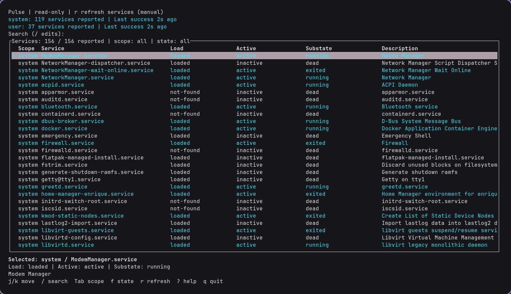
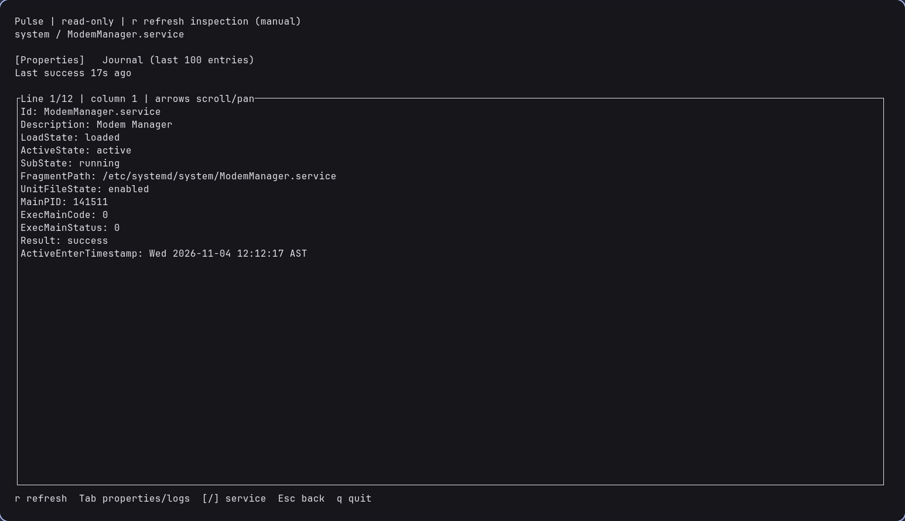
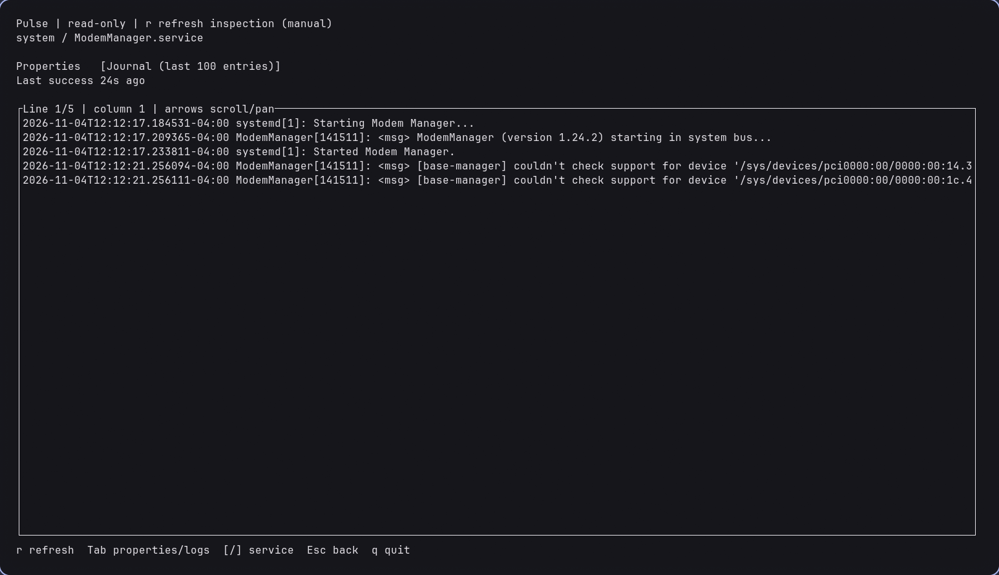

# Pulse

**Pulse** (Processes, Units, Logs, States & Events) is a read-only terminal
observatory for local systemd **services**, built with Rust, Ratatui, and Crossterm.
It brings service states, properties, and recent journal entries into a
keyboard-driven interface. Target MVP: **0.1.0**, pending release review.
The acronym does not imply general process monitoring.



## What it provides

- System and user `.service` listings with descriptions, load/active/substate,
  and manager scope.
- Keyboard navigation, search, scope/state filters, help, and resize handling.
- Service properties and bounded recent journal entries, with scrolling and panning.
- Manual refresh with selection retention, retrieval ages, and visible stale data.

Each manager and inspection pane reports its own loading, empty, permission-denied,
unavailable, or error state. Pulse keeps previous successful data visible when a
refresh fails, rather than presenting a failed read as an empty result.

All subprocesses use explicit arguments for `systemctl list-units`, `systemctl
show`, or `journalctl`. Pulse has no service controls, shell interpolation, remote
hosts, privilege escalation, system configuration changes, or journal uploads.

## Service inspection

Press `Enter` on a selected service to inspect its properties. The view includes
identity, state, unit-file metadata, main PID, exit status, and activation timestamp;
empty values and unreported fields remain distinct.



Switch to **Journal** with `Tab`, or open it directly from the list with `l`.
Pulse retrieves bounded recent entries without following or uploading logs.
Scroll through entries, pan long lines, and return to the list with `Esc`.



## Requirements

- Linux with systemd; **NixOS with systemd 260 on x86_64 is verified**. Other
  distributions and aarch64 runtime behavior remain unverified.
- `systemctl` and `journalctl` on `PATH`, and the current user's normal bus/journal
  access. An unavailable user manager or restricted journal does not require
  privileged execution: Pulse reports the observed error or warning.
- An interactive terminal on stdin/stdout, at least **60 columns × 16 rows** for
  the list/inspection view, with support for the displayed Unicode characters.
- For building: the pinned Nix shell, or a current stable Rust toolchain supporting
  edition 2024. An older minimum Rust version has not been established.
- Python 3 is needed only for the terminal lifecycle tests, not to run Pulse.

## Build and run

From a local checkout on NixOS:

```sh
nix develop
cargo build --locked --release
./target/release/pulse
```

`flake.lock` pins nixpkgs and the shell's Cargo, rustc, rustfmt, Clippy, and Python.
Shell definitions exist for x86_64 and aarch64 Linux. If flakes are not enabled,
use a per-command option, without changing NixOS configuration:

```sh
nix --extra-experimental-features 'nix-command flakes' develop
```

Without Nix, use your Rust toolchain and the same Cargo/build commands above.
Initial setup needs network access for uncached Nix inputs and Cargo dependencies.
For development, `cargo run --locked` starts the debug build. There is no approved
remote repository URL or published package to install yet.

The read-only discovery diagnostic also works without a TUI:

```sh
cargo run --locked --example discover
```

It prints each scope separately and exits unsuccessfully if either fails.

## Keyboard controls

| Key | Action |
| --- | --- |
| `Up`/`Down`, `k`/`j` | Move selection, clamped at either end |
| `PageUp`/`PageDown`, `Home`/`End` | Move a visible page, or first/last service |
| `/` | Edit case-insensitive search over names and descriptions |
| `Enter` / `Esc` while searching | Accept / cancel and restore previous search/selection |
| `Backspace`, `Ctrl-U` while searching | Delete a character / clear search |
| `Tab` from the list | Cycle scope: all, system, user |
| `f` from the list | Cycle active-state filter: all, active, failed, inactive |
| `r` from the list | Refresh both managers |
| `Enter`, `l` from the list | Inspect properties / open journal |
| `Tab` while inspecting | Switch Properties / Journal |
| `Up`/`Down`, `k`/`j`, paging, `Home`/`End` while inspecting | Scroll current pane |
| `Left`/`Right` while inspecting | Pan long lines |
| `[`/`]` while inspecting | Inspect previous/next visible service |
| `r` while inspecting | Refresh both properties and journal for this service |
| `Esc` while inspecting | Return to list, preserving selection |
| `?` | Open help; `?` or `Esc` closes help |
| `q` or `Esc` from the list | Quit (`q` also quits from help/inspection) |
| `Ctrl-C` | Quit in any mode |

Search and filters compose. Search input is limited to 256 bytes; `q`, `?`, and `r`
are literal text while editing. Clear an accepted search with `/`, `Ctrl-U`, `Enter`.
Resizing preserves selection; a resize prompt replaces views below the minimum size.

## Snapshots, access, and limits

Discovery runs on startup and manual refresh. Inspection is fetched on opening,
service changes, and manual refresh. **There is no periodic refresh or log follow.**
Inspection refresh does not also refresh the underlying service list.

Each manager/pane shows the age of its last successful retrieval. During a pending
or failed refresh, its previous data stays visible as `STALE`, retaining the
retrieval timestamp and latest error. `r` retries normal command failures. Successful empty results
replace old data. Initial failures do not fabricate empty results. `STALE` marks
pending/failed refreshes, rather than an arbitrary age threshold.

Selection follows `(scope, name)`. Refresh preserves search, filters, inspection
tab, and scroll/pan offsets where valid; removed/filtered rows fall back to the
first visible row and shrinking results clamp offsets. Superseded work is cancelled
and late results cannot replace a newer request.

- Discovery uses `list-units --all --type=service`: units known to each manager,
  including inactive and not-found entries. **Unloaded installed service files
  are not enumerated.** Discovery commands allow five seconds and 4 MiB combined
  stdout/stderr each.
- Properties include identity, description, load/active/substate, fragment path,
  unit-file state, main PID, exit code/status, result, and active-enter timestamp.
  Empty values and unreported fields are distinct.
- Inspection commands allow five seconds and **512 KiB** combined output each.
  Journal retrieval requests the last **100 entries**, in chronological order;
  `End` jumps to the last displayed line. Display is capped at **2,000 journal
  lines** and **4,096 input characters per property/log line** before escaping,
  with truncation markers. Exceeding the subprocess byte limit reports an error.
- Malformed property/list output or invalid UTF-8 reports an error. Untrusted
  terminal controls and bidirectional formatting are escaped. Long status summaries
  are abbreviated; inspection supports horizontal panning.
- Access warnings remain visible with empty/partial journal results. No returned
  entries is not proof that no entries exist. Pulse never tries to grant access.
- Terminal restoration is attempted on normal exit, I/O errors, and unwinding UI
  panics. SIGKILL and an inaccessible terminal can prevent cleanup. An unexpected
  internal worker termination may require quitting and reopening Pulse.

Other unit types, service controls, remote hosts, and general process monitoring
remain out of scope.

## Development and validation

UI/input state, rendering, typed models, parsing, adapters, and subprocess execution
are separate modules. Discovery and inspection use a shared bounded worker: one
running request, one replaceable pending request, two results. Generation IDs reject
obsolete results; inspection also checks scope/name. Workers cancel and reap their
direct child processes and join after terminal restoration. `rustix` provides safe
nonblocking pipe operations; there are three direct Rust dependencies.

Run the full gate in the pinned shell:

```sh
nix flake check --all-systems --no-update-lock-file
nix develop
cargo fmt --all -- --check
cargo clippy --locked --all-targets --all-features -- -D warnings
cargo test --locked --all-targets --all-features
cargo build --locked --all-targets --all-features
python3 tests/terminal_pty.py
```

Tests cover parsing fixtures, scope/name arguments, navigation, selection, refresh
failure/recovery, stale generations, output bounds, timeouts, and cancellation.
The terminal PTY suite checks success, I/O failure, UI panic, worker panic, and a
panic after the session. Its ignored Rust fixture is invoked by the Python suite;
the separate ignored subprocess fixture is invoked by runner tests.

CI is configured to run the locked Cargo gate on stable Rust and in the pinned Nix
shell, validate both Nix shell definitions, and run terminal PTY regressions. Hosted Actions runs
remain unverified until an approved repository exists and the workflow runs there.
Manual live checks should also cover both managers, properties/logs, search/filters,
refresh, resizing, quit during loading, and restored terminal settings.

See [docs/READINESS.md](docs/READINESS.md) for the 0.1.0 review and remaining decisions,
and [docs/PROGRESS.md](docs/PROGRESS.md) for the current handoff.

## Release and licensing

Pulse is licensed under the [MIT License](LICENSE). Copyright (c) 2026 Carlos
Enrique Jimenez Sosa. Dependencies retain their own licenses; see
[third-party notices](THIRD_PARTY_NOTICES.md) for upstream texts and unresolved
attribution and distribution checks. Binary-distribution licensing has not been
fully cleared; screenshot ownership and third-party material remain to be verified.

Cargo publishing remains disabled (`publish = false`). The `pulse`
repository/executable name's availability has not been cleared. Repository/name
approval and release/tag/publication approval remain with the owner. No release
has been published.
